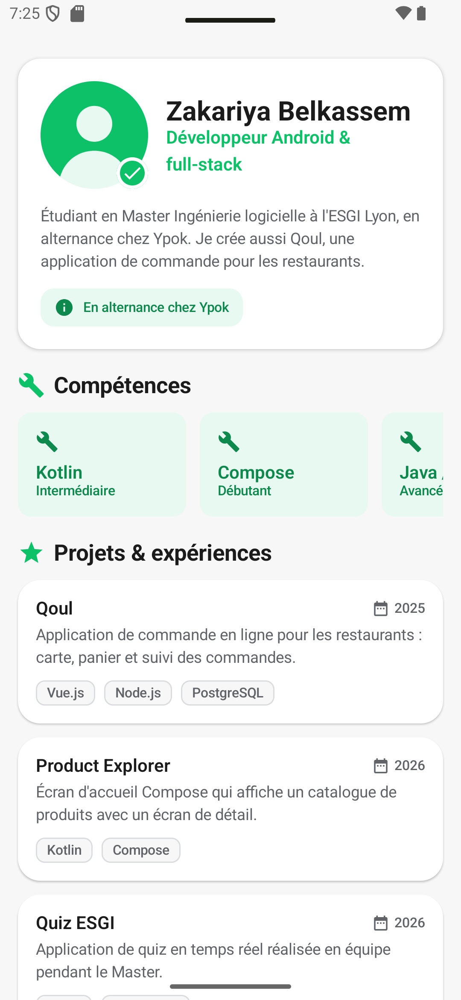
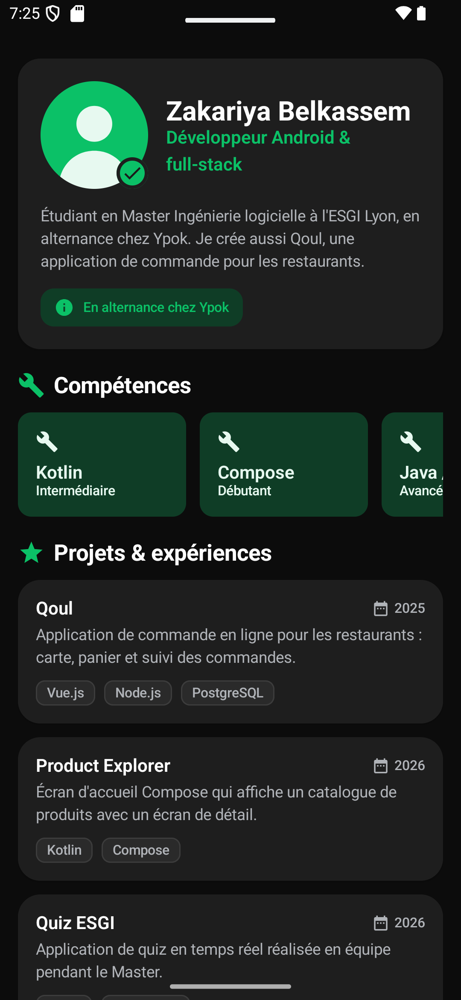
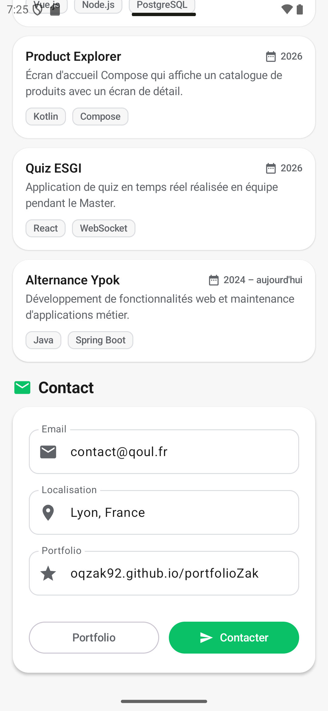
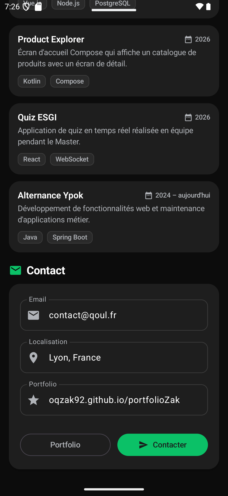

# Profil développeur – Amélioration UI (Jetpack Compose)

Deuxième version de mon application **Profil développeur**, retravaillée avec les notions du chapitre
**Compose UI** : composants fondamentaux, layouts, listes `LazyColumn` / `LazyRow`, cartes réutilisables
et Material Design 3 avec un thème clair et un thème sombre.

> La première version (devoir précédent) est dans un autre dépôt :
> [profil-developpeur-compose](https://github.com/oqzak92/profil-developpeur-compose)

| Clair | Sombre |
|---|---|
|  |  |
|  |  |

## Description

L'application affiche le profil d'un développeur sur un seul écran qui défile :

- un **en-tête** avec l'avatar (et un badge de disponibilité superposé), le **nom**, le **rôle**,
  une **courte description** et la disponibilité ;
- une liste horizontale de **compétences** (nom + niveau) ;
- une liste de **projets et expériences** (titre, année, description, technologies) ;
- une **zone de contact** avec l'email, la localisation et le portfolio en lecture seule ;
- deux **actions** : « Portfolio » et « Contacter » (callbacks vides pour l'instant).

Toutes les données sont **locales**, écrites en Kotlin dans `data/Profil.kt` (`profilZakariya` et un
deuxième profil fictif `profilSarah` utilisé dans une preview). Pas d'API, de ViewModel, de Navigation
ni de stockage local.

### Organisation du code

```
app/src/main/java/com/example/profildeveloppeur/
├── MainActivity.kt                   // Scaffold + EcranProfil
├── data/Profil.kt                    // data classes Profil, Competence, Projet + données locales
├── ui/EcranProfil.kt                 // écran principal (LazyColumn) + previews de l'écran
├── ui/components/ProfilComposants.kt // composables réutilisables + previews des composants
└── ui/theme/                         // Color.kt, Theme.kt, Type.kt, Shape.kt
```

## Composants Compose utilisés

| Composant | Où |
|---|---|
| `Text` | nom, rôle, description, titres de section, contenu des cartes |
| `Button` / `OutlinedButton` | actions « Contacter » et « Portfolio » (`ZoneContact`) |
| `Icon` | badge de l'avatar, titres de section, `SkillCard`, année des projets, champs de contact, bouton |
| `Image` | avatar (`painterResource(R.drawable.avatar_placeholder)`, découpé en cercle avec `clip(CircleShape)`) |
| `Card` | `EnTeteProfil`, `SkillCard`, `ProjectCard`, `ZoneContact` |
| `OutlinedTextField` (`readOnly = true`) | `ChampInfo` : email, localisation, portfolio |
| `Surface` | fond de l'écran, `BadgeDisponibilite`, `TechnologyChip`, badge de l'avatar |
| `Scaffold` | dans `MainActivity`, son `innerPadding` est transmis à la `LazyColumn` |

Composables réutilisables créés : `AvatarAvecBadge`, `EnTeteProfil`, `BadgeDisponibilite`,
`TitreSection`, `SkillCard`, `TechnologyChip`, `ProjectCard`, `ChampInfo`, `ZoneContact`, `EcranProfil`.
Chacun reçoit ses données en paramètre et un `modifier: Modifier = Modifier`.

## Layouts utilisés

- **`Column`** : structure verticale de chaque carte (en-tête, compétence, projet, contact) ;
- **`Row`** : avatar + nom/rôle, icône + titre de section, titre + année d'un projet, chips de
  technologies, les deux boutons côte à côte (avec `Modifier.weight(1f)`) ;
- **`Box`** : `AvatarAvecBadge`, le badge (✓ ou ✗) est superposé en bas à droite de l'image avec
  `Modifier.align(Alignment.BottomEnd)` ;
- **`Spacer`** : espaces horizontaux (`width`) et verticaux (`height`) entre les éléments ;
- **`Surface`** : fond de l'écran en `colorScheme.background`, badge de disponibilité, chips ;
- **`LazyColumn`** / **`LazyRow`** : voir ci-dessous.

## Listes avec LazyColumn et LazyRow

- **`LazyColumn`** (dans `EcranProfil`) : c'est le conteneur de tout l'écran. Elle contient des
  `item { }` pour l'en-tête, les titres de section et la zone de contact, et
  `items(profil.projets, key = { it.titre }) { ProjectCard(it) }` pour la **liste des projets**.
  Une seule liste qui défile évite une `Column` + `verticalScroll`, et seuls les éléments visibles
  sont composés. `contentPadding` gère les marges et le padding du `Scaffold`,
  `verticalArrangement = Arrangement.spacedBy(12.dp)` espace les éléments.
- **`LazyRow`** (dans un `item` de la `LazyColumn`) : la **liste des compétences** défile
  horizontalement, chaque élément est une `SkillCard`. Une liste horizontale dans une liste verticale
  ne pose pas de problème de mesure (les deux sens de défilement sont différents).
- Chaque élément est affiché par un **composable réutilisable** (`SkillCard`, `ProjectCard`), avec une
  `key` stable.

## Choix du thème (Material Design 3)

- **Couleurs** (`Color.kt`, `Theme.kt`) : je garde l'identité de mon projet **Qoul** (vert `#0BC167`).
  Deux `ColorScheme` sont définis : `lightColorScheme` (fond gris très clair, cartes blanches) et
  `darkColorScheme` (fond presque noir, cartes gris foncé, conteneurs vert foncé). Le thème suit le
  système (`isSystemInDarkTheme()`) ; les couleurs dynamiques d'Android 12 sont désactivées pour garder
  la même identité partout.
- Dans les composables, **aucune couleur n'est écrite en dur** : tout passe par
  `MaterialTheme.colorScheme` (`primary`, `primaryContainer`, `secondaryContainer`, `surface`,
  `surfaceVariant`, `outline`, `error`/`errorContainer` pour un profil indisponible…), donc le mode
  sombre fonctionne automatiquement.
- **Typographie** (`Type.kt`) : `headlineSmall` pour le nom, `titleLarge` pour les titres de section,
  `titleMedium` pour les titres de carte, `bodyMedium` pour les textes, `labelMedium` pour les chips et
  niveaux.
- **Formes** (`Shape.kt`) : `small` 8 dp (chips), `medium` 12 dp (compétences, badge, champs),
  `large` 20 dp (grandes cartes), utilisées via `MaterialTheme.shapes`.

## Previews

- `PreviewEcranClair` : l'écran complet en thème clair ;
- `PreviewEcranSombre` : l'écran complet en thème sombre (`uiMode = UI_MODE_NIGHT_YES`) ;
- `PreviewEcranAutreProfil` : un autre profil, indisponible (badge et conteneur rouges) ;
- `PreviewSkillCard` et `PreviewProjectCard` : les composants seuls.

## Lancer le projet

Ouvrir le dossier dans Android Studio puis lancer la configuration `app`
(ou `./gradlew assembleDebug`).

## Quelles notions du chapitre Compose UI avez-vous réutilisées dans cette application ?

J'ai réutilisé les **composants fondamentaux** (`Text`, `Button`, `Icon`, `Image`, `Card`,
`OutlinedTextField` en lecture seule) et les **layouts** (`Column`, `Row`, `Box` pour superposer le
badge sur l'avatar, `Spacer`, `Surface`). J'ai remplacé la boucle `for` de la première version par des
**listes modernes** : une `LazyColumn` pour l'écran et les projets, et une `LazyRow` pour les
compétences, chaque élément étant affiché par une **carte réutilisable** (`SkillCard`, `ProjectCard`).
Enfin, j'ai appliqué **Material Design 3** : un `colorScheme` clair et sombre, une typographie et des
formes personnalisées utilisées partout via `MaterialTheme`, avec des previews pour vérifier les deux
rendus.
